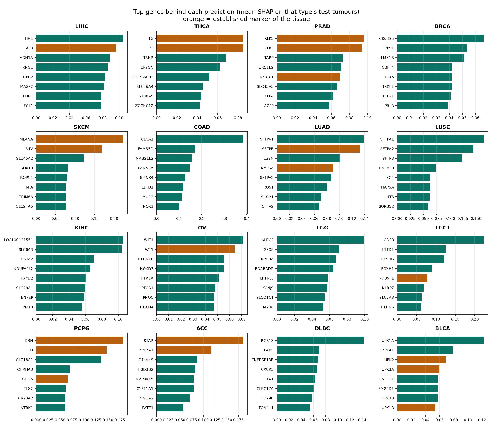
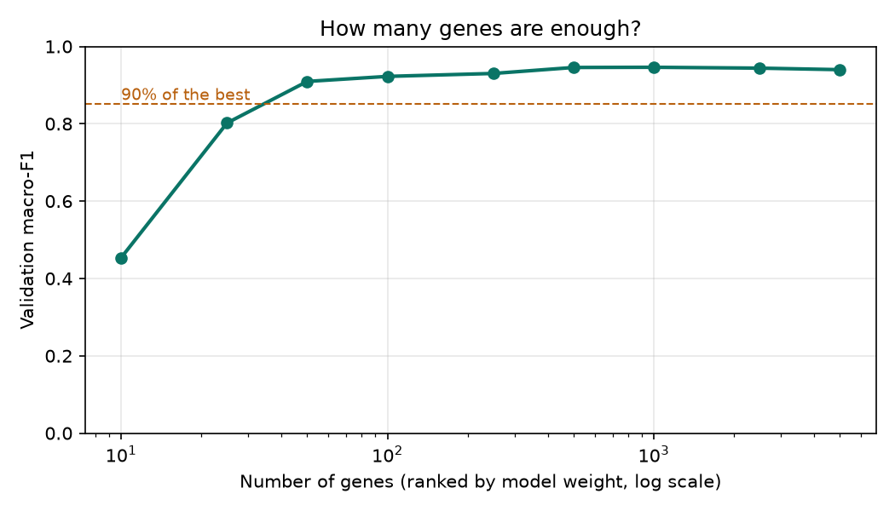
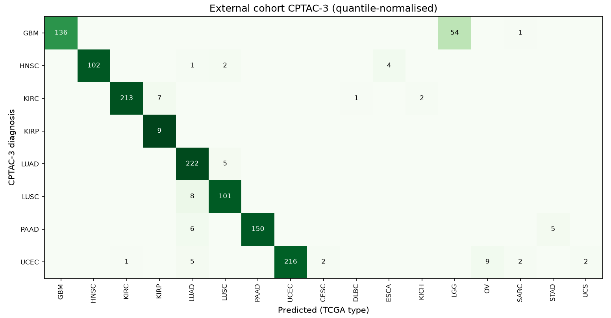
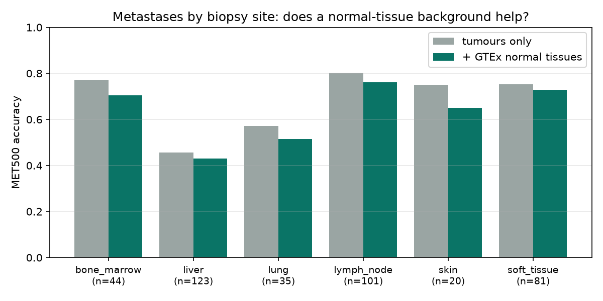
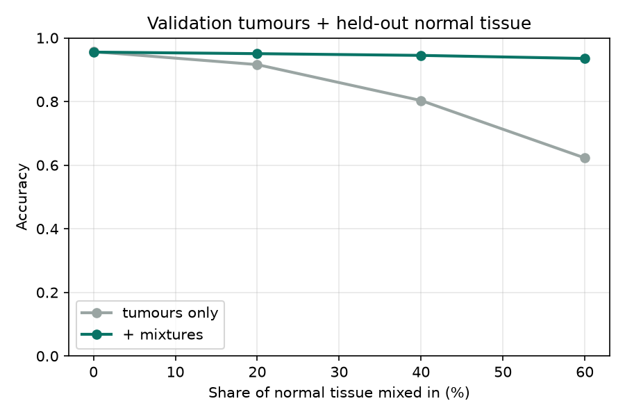
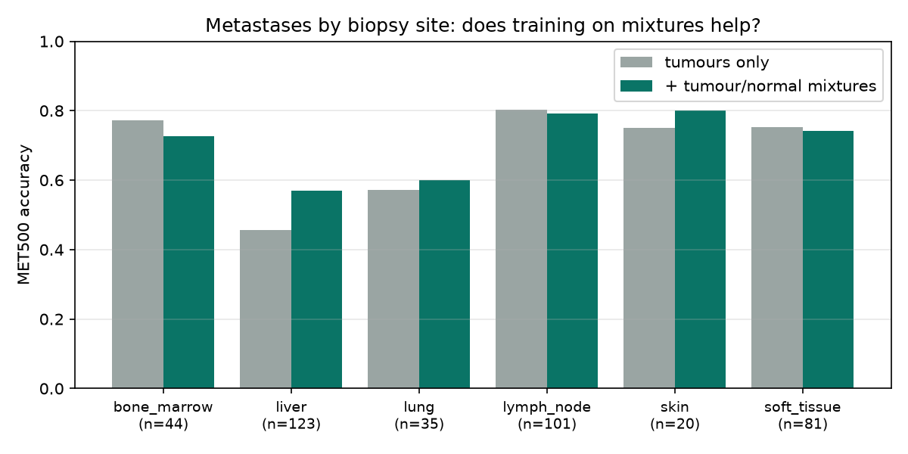

# OncoType-Expr

[](https://github.com/arsennysan/oncotype-expr/actions/workflows/tests.yml)
[](LICENSE)

**Which tissue did a tumour come from? A pan-cancer classifier on TCGA RNA-seq, built to be leakage-safe and interpretable.**

About 3–5% of cancer patients present with metastases whose primary site cannot be found ("cancer of unknown primary"). Gene-expression classifiers are one way to suggest the tissue of origin. This project builds such a classifier on public TCGA data and focuses on doing it honestly: no information from the test set leaks into training, the metrics hold up under class imbalance, and the errors are explained biologically.

> **Status:** stages 0–8 done: data, exploration, models, SHAP interpretation, robustness checks, external validation on two independent cohorts, and two pre-registered experiments on metastases: a normal-tissue background class (negative) and tumour/normal mixture augmentation (positive). See [Roadmap](#roadmap).

**Highlights**

- Test macro-F1 **0.956**, accuracy **97.0%**, right answer in the top three for **99.8%** of tumours (32 cancer types).
- The model's top genes are textbook tissue markers: STAR, MLANA, KLK2, TG and DBH rank **#1** for their tissue; ALB, WT1 and SFTPB rank #2.
- **Metastases** it never saw: 92% accuracy, 98% top-3. **Hospitals** it never saw: macro-F1 drops only from 0.938 to 0.916.
- **50 genes** give over 90% of the full performance; 500 genes match it.
- **Independent cohorts**, no retraining: 90.8% accuracy (top-3 99.3%) on CPTAC-3 primary tumours from other hospitals; 65.7% (top-3 81%) on MET500 metastases, where the main failure is reading the organ the biopsy came from.
- Adding GTEx normal tissues as background classes does **not** fix that (MET500 66.4% → 62.9%), and the notebook explains why (in a multinomial model, the LIHC-vs-BRCA comparison ignores the background class).
- **Training on tumour + normal-tissue mixtures does help:** MET500 66.4% → 69.6% (paired McNemar p = 0.049), liver metastases called liver cancer 41 → 16, primary-tumour accuracy unchanged.
- Found and fixed a data trap: ~3,000 genes are missing only in certain sequencing batches, so imputing them would let the model recognise the batch instead of the tumour.

## Results

Test set: 1,452 primary tumours, 32 cancer types, scored once after model choice on the validation set.

| Model | Macro-F1 | Balanced accuracy | Accuracy | Top-3 accuracy |
|---|---|---|---|---|
| Majority class (reference) | 0.006 | 0.031 | 0.113 | 0.127 |
| **Logistic regression** (L2, C = 0.1, 5,000 genes), chosen on validation | **0.956** | **0.958** | **0.970** | **0.998** |
| LightGBM (2,000 genes) | 0.930 | 0.934 | 0.957 | 0.992 |

**Where the model errs.** 44 of 1,452 test tumours are misclassified, and the errors concentrate in biologically close pairs:

| Confusion | Errors | Why it is expected |
|---|---|---|
| Colon (COAD) ↔ rectum (READ) | 19 | Essentially one disease, colorectal adenocarcinoma, split by anatomical site |
| Oesophagus (ESCA) ↔ stomach (STAD) | 4 | Oesophageal adenocarcinoma near the junction is molecularly close to gastric cancer |
| Low-grade glioma (LGG) ↔ glioblastoma (GBM) | 2 | A grading continuum of the same tissue |
| Kidney clear-cell (KIRC) ↔ papillary (KIRP) | 2 | Two subtypes of renal cell carcinoma |
| Cervix (CESC) ↔ endometrium (UCEC) | 2 | Neighbouring parts of the uterus |

The right answer is among the top three guesses for 99.8% of tumours.


## What the exploration showed


- Most cancer types form their own clusters (87% of a tumour's 15 nearest neighbours share its type). Organs with a shared origin sit together: kidney subtypes, liver and bile ducts, the digestive tract, and **squamous cancers of different organs** (head and neck, lung, cervix, oesophagus), where cell type matters more than organ.
- Breast cancer splits into two clouds; the smaller one is the basal-like ("triple-negative") subtype.
- **Collection-site signal:** within breast cancer, the hospital that collected a sample can be guessed from expression at about twice the chance rate (15% vs 7%). The signal is weak next to the differences between cancer types, but it is real, so a held-out-site test is on the roadmap.

Details and explanations (in Russian) are in [`notebooks/01_explore.ipynb`](notebooks/01_explore.ipynb).

## What the model looks at (SHAP)

For logistic regression, a gene's SHAP value is exact: coefficient × standardised expression (checked against `shap.LinearExplainer`, difference 2·10⁻⁸). Averaging over each cancer type's test tumours gives its most important genes. The list of known markers was written down **before** looking at the results.



| Cancer type | Known marker | Rank among 5,000 genes |
|---|---|---|
| Adrenocortical (ACC) | STAR | 1 |
| Melanoma, skin and eye (SKCM, UVM) | MLANA | 1 |
| Prostate (PRAD) | KLK2 | 1 |
| Thyroid (THCA) | TG | 1 |
| Pheochromocytoma (PCPG) | DBH | 1 |
| Liver (LIHC) | ALB | 2 |
| Ovary (OV) | WT1 | 2 |
| Lung adenocarcinoma (LUAD) | SFTPB | 2 |
| Bladder (BLCA), mesothelioma (MESO), pancreas (PAAD) | UPK2, UPK3B, CPA2 | 3 |
| Testis (TGCT) | POU5F1 | 5 |

Of 55 markers present in the gene set, 27 are in the top 10 for their tissue and 42 in the top 50 ([full table](results/marker_check.csv)). Two findings stand out:

- **Shared lineage markers rank low.** PAX8 (kidney, ovary, endometrium) and KRT5 (all squamous cancers) are real markers but do not separate classes, so the model relies on other genes.
- **The model partly reads the surrounding normal tissue.** For squamous lung cancer (LUSC) the top genes are surfactants SFTPA1/SFTPA2/SFTPB, which come from normal lung alveoli, not tumour cells. This works for primary tumours and predicts trouble for metastases, which is what the robustness check found.

## Robustness

The test set was used once and is not touched here; checks 2 and 3 use the training and validation tumours only (`src/robustness.py`).

**1. Metastases** (394 TCGA metastases, never seen in training; the model learned on primary tumours only).

| | n | Accuracy |
|---|---|---|
| All metastases | 394 | 0.924 (top-3: 0.980) |
| Melanoma | 368 | 0.932 |
| Other types | 26 | 0.808 |

Melanoma errors are mostly sarcoma (12; spindle-cell melanomas can look like sarcoma even under the microscope) and uveal melanoma (4, the same melanocyte lineage). Two breast cancer metastases were called liver cancer and mesothelioma, most likely because they were sampled from the liver and pleura: the same normal-tissue effect seen in the SHAP analysis.

**2. Hospitals the model never saw.** Five-fold cross-validation on 8,224 tumours from 680 collection sites, split at random vs. grouped by site (`GroupKFold`), so every held-out tumour comes from an unseen hospital.

| Split | Macro-F1 | Accuracy |
|---|---|---|
| Random | 0.938 | 0.957 |
| Unseen sites | 0.916 | 0.942 |

The drop is small: the model uses a little site-specific signal, but its main signal transfers to new centres.

**3. How many genes are enough?** Genes ranked by model weight, model refitted on the top k, scored on validation.



50 genes reach macro-F1 0.909 (over 90% of the best), 500 genes reach the maximum of 0.946, and more genes add only noise. A targeted panel of a few hundred genes would be enough in principle.

Explanations in Russian: [`notebooks/02_interpret_and_robustness.ipynb`](notebooks/02_interpret_and_robustness.ipynb).

## External validation on independent data

The TCGA-trained model, unchanged, applied to two cohorts collected by other groups with other pipelines (`src/external.py`):

- **CPTAC-3**: 1,266 primary tumours of 8 types from the prospective CPTAC project (GDC STAR pipeline, log2(TPM + 1)).
- **MET500**: 437 metastatic biopsies from the University of Michigan (Robinson et al., *Nature* 2017; log2(TPM + 0.001), partly exome-capture libraries).

Each external sample is **quantile-normalised to the TCGA training distribution on its own**: its gene ranking is kept and the values are replaced by those of a typical TCGA sample. No information from the rest of the cohort or its labels is used. Genes missing from the external data (10–13% of the model's genes, due to renamed or differently annotated genes) are filled with the TCGA training median.

| Cohort | Raw values | Quantile-normalised | Top-3 (normalised) |
|---|---|---|---|
| TCGA test set (reference) | | 0.970 | 0.998 |
| **CPTAC-3**, primary tumours | 0.134 | **0.908** | 0.993 |
| **MET500**, metastases | 0.064 | **0.657** | 0.810 |



- **Normalisation is essential.** On raw values the model is close to chance; matching the scale recovers almost all of the performance on CPTAC-3.
- **CPTAC-3:** every type except glioblastoma is recognised at 91–100%. The main error is glioblastoma → low-grade glioma (54 of 191), the same tissue at a different grade; without that pair accuracy would be about 95%.
- **MET500:** metastases biopsied from the liver are the worst case (44% accuracy vs 80% for lymph nodes). Breast cancer in the liver is called liver cancer 16 times, and **55 of 150 errors name the organ the biopsy was taken from**. This confirms on independent data what the SHAP analysis and the TCGA metastases suggested: the model partly reads surrounding normal tissue.
- Possible fixes: train on tumour + normal-tissue mixtures, deconvolve tumour from normal signal, or train on within-sample ranks. A normal-tissue background class was tried next and did not help (below).

Explanations in Russian: [`notebooks/03_external_validation.ipynb`](notebooks/03_external_validation.ipynb).

## Normal tissues as a background class (negative result)

Idea: add GTEx normal tissues (3,339 samples, 26 organs) as extra classes such as `NORMAL_Liver`, so organ signal has somewhere to go; at prediction time drop them and renormalise over the 32 tumour types (`src/background.py`). Design fixed before looking at results: same genes and settings for both models, genes restricted to those present in both TCGA and GTEx (15,629), GTEx normalised like external data, MET500 used only for the final comparison.

| Model | TCGA test | CPTAC-3 | MET500 | MET500 top-3 | Liver metastases called LIHC |
|---|---|---|---|---|---|
| Tumours only | 0.970 | 0.908 | **0.664** | 0.817 | 41 |
| + GTEx normal tissues | 0.972 | **0.926** | 0.629 | 0.801 | 41 |



The normal classes are learned well (99.5% on held-out GTEx donors) and primary tumours improve slightly, but metastases get worse at every biopsy site. The reason is structural: in multinomial logistic regression, P(LIHC)/P(BRCA) = exp((w_LIHC − w_BRCA)·x) does not involve the background class at all. Liver genes still separate LIHC from BRCA in training, so a breast metastasis in the liver, which is a mixture of both, still leans towards LIHC. Training on such mixtures was tried next (below).

Explanations in Russian: [`notebooks/04_normal_background.ipynb`](notebooks/04_normal_background.ipynb).

## Training on tumour + normal-tissue mixtures

A metastasis biopsy is tumour plus the normal tissue of the host organ, so the model is shown exactly that (`src/mixtures.py`). Each TCGA training tumour gets one extra copy blended with a random GTEx normal sample in linear space, log2((1 − a)·tumour + a·normal + 1) with a ~ U(0.1, 0.6), and keeps its tumour label. Design fixed before looking at results: normal samples from GTEx training donors only, same genes and settings as the tumours-only model, MET500 used only for the final comparison.

**Check without MET500:** validation tumours blended with normal tissue from held-out GTEx donors.



At 60% normal tissue the usual model drops to 62% while the mixture model keeps 94%. This check is optimistic (same mixing process as training); real metastases are the actual test:

| Model | TCGA test | CPTAC-3 | MET500 | MET500 top-3 | Liver metastases called LIHC |
|---|---|---|---|---|---|
| Tumours only | 0.970 | 0.908 | 0.664 | 0.817 | 41 |
| + normal tissues as classes | 0.972 | 0.926 | 0.629 | 0.801 | 41 |
| **+ tumour/normal mixtures** | 0.970 | 0.907 | **0.696** | 0.815 | **16** |



- Liver biopsies improve most (46% → 57%), and liver metastases mistaken for liver cancer fall 2.5-fold.
- The two models disagree on 44 patients: the mixture model is right on 29, the baseline on 15 (exact McNemar p = 0.049). A real but modest gain, not a breakthrough.
- Mixtures change the training examples themselves (a breast tumour with high liver genes, labelled breast), which is what the background class could not do.
- Not tuned: the normal share and number of mixtures were set once. Tuning them should use synthetic mixtures or validation data, never MET500.

Explanations in Russian: [`notebooks/05_mixture_augmentation.ipynb`](notebooks/05_mixture_augmentation.ipynb).

## A data trap: platform-dependent missing genes

The first version dropped every gene with any missing value and lost about 4,000 genes, including well-known markers. A closer look showed two different groups:

- **~3,000 genes are missing in 5–20% of samples, all from a few batches** (stomach, endometrium, ovary, oesophagus, colon, rectum) measured on a different platform version. Filling these gaps would let the model learn "value missing → stomach", i.e. recognise the batch instead of the tumour. They are excluded. The cost: lung markers NKX2-1 and SFTPC, glioma marker OLIG2 and melanoma marker TYR are lost.
- **~1,100 genes have rare gaps** (under 1% of samples, 27 stomach tumours). They are kept and filled with the training median inside the model pipeline.

## How leakage is avoided

- **One primary tumour per patient**, so no patient can be in both training and test data.
- **Stratified 70/15/15 split** of patients; every cancer type, even the smallest (36 tumours), reaches the test set.
- **Gene filtering uses training samples only** (`src/prepare.py`), and gene selection and scaling live inside scikit-learn pipelines, so they are fitted on training data and only applied to validation and test data.
- **Model choice on the validation set; the test set is scored once**, at the end.
- These rules are covered by unit tests (`tests/`).

## Data

[TCGA Pan-Cancer Atlas](https://gdc.cancer.gov/about-data/publications/pancanatlas) via [UCSC Xena](https://xenabrowser.net/datapages/?cohort=TCGA%20PanCanAtlas): batch-corrected RNA-seq (EB++, log2), sample annotations and the TCGA Clinical Data Resource (Liu et al., *Cell* 2018).

- 9,676 primary solid tumours from 32 cancer types; 17,456 genes after filtering.
- 394 metastases are kept aside for the robustness test.
- Normal tissues: [GTEx](https://gtexportal.org/) via the UCSC Toil Xena hub (RSEM normalised counts).
- External cohorts: [CPTAC-3](https://proteomics.cancer.gov/programs/cptac) (via the GDC Xena hub) and [MET500](https://met500.path.med.umich.edu/) (via the UCSC public Xena hub).
- Acute myeloid leukaemia (LAML) is not included: it is a blood cancer with no solid primary tumour sample.

Data is downloaded by a script and never committed.

## Run it

```bash
python -m venv .venv
.venv/Scripts/activate          # Windows; on macOS/Linux: source .venv/bin/activate
pip install -r requirements.txt
python -m src.download          # ~335 MB from UCSC Xena, resumable
python -m src.prepare           # ~1 min
python -m src.train             # ~2–3 min
python -m src.interpret         # SHAP top genes and marker check
python -m src.robustness        # metastases, unseen sites, gene budget (~15 min)
python -m src.external          # CPTAC-3 and MET500 (downloads ~950 MB)
python -m src.background        # GTEx background-class experiment (downloads ~670 MB)
python -m src.mixtures          # tumour/normal mixture augmentation
python -m pytest -q tests
```

## Project structure

```
src/download.py     fetch TCGA files (resumes dropped downloads, checks sizes)
src/prepare.py      barcodes, sample selection, leakage-free split, gene filtering
src/models.py       pipelines (top-variance genes → scaling → classifier) and metrics
src/train.py        model comparison, single test evaluation, figures
src/interpret.py    per-gene contributions (exact SHAP), known-marker check
src/robustness.py   metastases, unseen collection sites, gene budget
src/external.py     independent cohorts: gene-id mapping, per-sample quantile normalisation
src/background.py   GTEx normal tissues as background classes, compared on all cohorts
src/mixtures.py     training on tumour/normal mixtures, synthetic check, paired test on MET500
notebooks/          exploration with explanations
results/            metrics.json, per-class report, figures
tests/              unit tests on synthetic data, run by GitHub Actions
```

## Roadmap

- [x] Data download and leakage-free preparation
- [x] Exploration: class balance, UMAP, collection-site signal
- [x] Baseline models: logistic regression, LightGBM; honest test evaluation
- [x] SHAP interpretation: does the model recover known tissue markers?
- [x] Robustness: TCGA metastases, held-out collection sites
- [x] How few genes are enough for 90% of the performance
- [x] External validation on independent data (CPTAC-3, MET500)
- [x] Normal-tissue background class (did not help on metastases)
- [x] Tumour + normal-tissue mixture augmentation (MET500 +3 points, p = 0.049)
- [ ] Tune the mixing on validation data; try it with LightGBM and other metastasis cohorts
- [ ] Small demo app

## Limitations

This is a learning and research project, **not a diagnostic tool**. TCGA tumours are high-quality research samples; real clinical samples are noisier, and accuracy on metastases is lower than on primary tumours (92% vs 97%), and on independent metastases (MET500) it drops to 66%, mostly because of normal tissue from the biopsy site.

## Credits

Built with the help of [Claude Code](https://claude.com/claude-code).

## License

[MIT](LICENSE)
