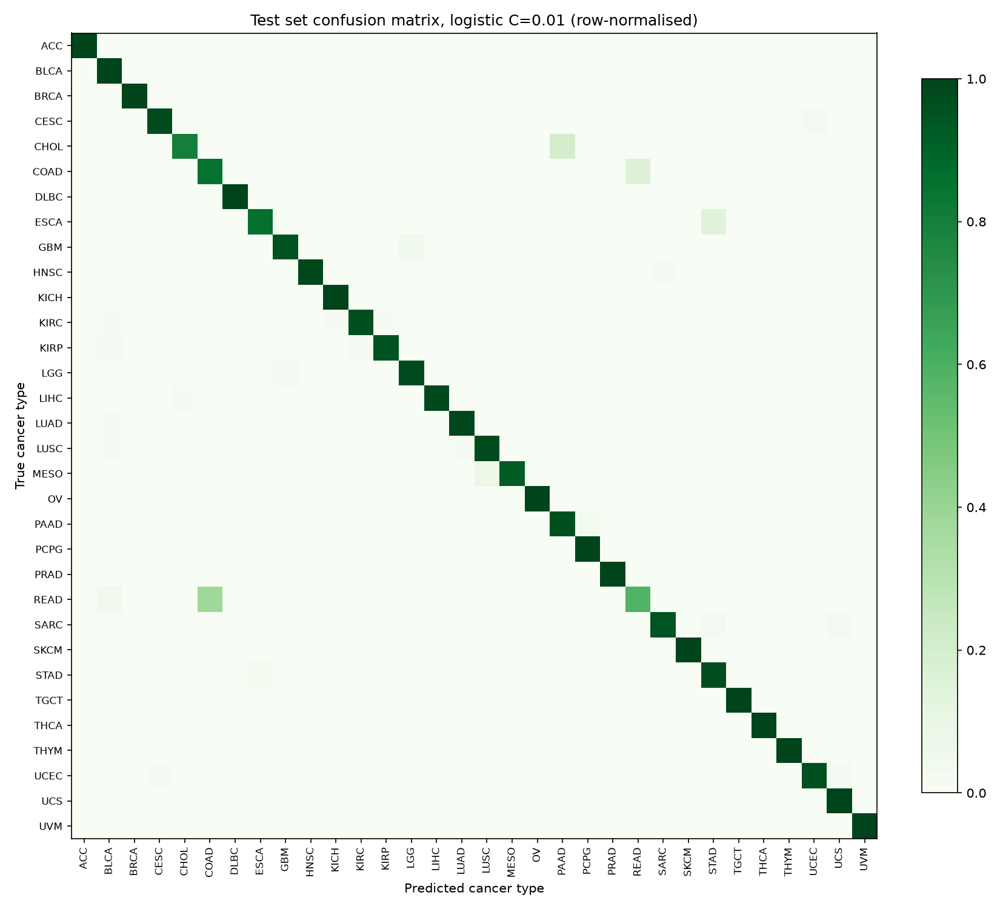
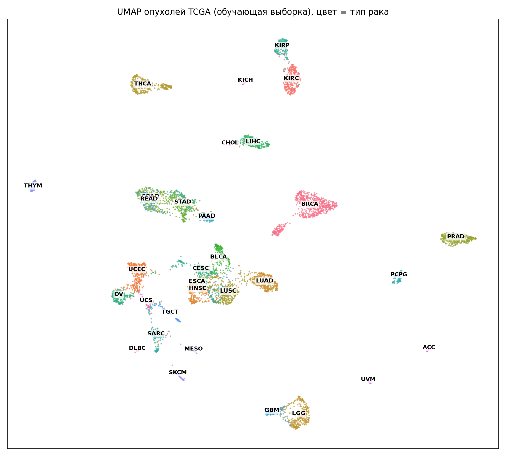

# OncoType-Expr

[](https://github.com/arsennysan/oncotype-expr/actions/workflows/tests.yml)
[](LICENSE)

**Which tissue did a tumour come from? A pan-cancer classifier on TCGA RNA-seq, built to be leakage-safe and interpretable.**

About 3–5% of cancer patients present with metastases whose primary site cannot be found ("cancer of unknown primary"). Gene-expression classifiers are one way to suggest the tissue of origin. This project builds such a classifier on public TCGA data and focuses on doing it honestly: no information from the test set leaks into training, the metrics hold up under class imbalance, and the errors are explained biologically.

> **Status:** stages 0–3 done (data, exploration, baseline models). Next: SHAP interpretation, validation on metastases and unseen collection sites. See [Roadmap](#roadmap).

## Results so far

Test set: 1,452 primary tumours, 32 cancer types, scored once after model choice on the validation set.

| Model | Macro-F1 | Balanced accuracy | Accuracy | Top-3 accuracy |
|---|---|---|---|---|
| Majority class (reference) | 0.006 | 0.031 | 0.113 | 0.127 |
| **Logistic regression** (L2, C = 0.01, 5,000 genes), chosen on validation | **0.952** | **0.956** | **0.966** | **0.997** |
| LightGBM (2,000 genes) | 0.929 | 0.931 | 0.957 | 0.994 |

**Where the model errs.** 49 of 1,452 test tumours are misclassified, and the errors concentrate in biologically close pairs:

| Confusion | Errors | Why it is expected |
|---|---|---|
| Colon (COAD) ↔ rectum (READ) | 19 | Essentially one disease, colorectal adenocarcinoma, split by anatomical site |
| Oesophagus (ESCA) ↔ stomach (STAD) | 6 | Oesophageal adenocarcinoma near the junction is molecularly close to gastric cancer |
| Low-grade glioma (LGG) ↔ glioblastoma (GBM) | 3 | A grading continuum of the same tissue |
| Endometrium (UCEC) → uterine carcinosarcoma (UCS) | 2 | Same organ, overlapping histology |

The right answer is among the top three guesses for 99.7% of tumours.



## What the exploration showed



- Most cancer types form their own clusters (87% of a tumour's 15 nearest neighbours share its type). Organs with a shared origin sit together: kidney subtypes, liver and bile ducts, the digestive tract, and **squamous cancers of different organs** (head and neck, lung, cervix, oesophagus), where cell type matters more than organ.
- Breast cancer splits into two clouds; the smaller one is the basal-like ("triple-negative") subtype.
- **Collection-site signal:** within breast cancer, the hospital that collected a sample can be guessed from expression at about twice the chance rate (15% vs 7%). The signal is weak next to the differences between cancer types, but it is real, so a held-out-site test is on the roadmap.

Details and explanations (in Russian) are in [`notebooks/01_explore.ipynb`](notebooks/01_explore.ipynb).

## How leakage is avoided

- **One primary tumour per patient**, so no patient can be in both training and test data.
- **Stratified 70/15/15 split** of patients; every cancer type, even the smallest (36 tumours), reaches the test set.
- **Gene filtering uses training samples only** (`src/prepare.py`), and gene selection and scaling live inside scikit-learn pipelines, so they are fitted on training data and only applied to validation and test data.
- **Model choice on the validation set; the test set is scored once**, at the end.
- These rules are covered by unit tests (`tests/`).

## Data

[TCGA Pan-Cancer Atlas](https://gdc.cancer.gov/about-data/publications/pancanatlas) via [UCSC Xena](https://xenabrowser.net/datapages/?cohort=TCGA%20PanCanAtlas): batch-corrected RNA-seq (EB++, log2), sample annotations and the TCGA Clinical Data Resource (Liu et al., *Cell* 2018).

- 9,676 primary solid tumours from 32 cancer types; 16,169 genes after filtering.
- 394 metastases are kept aside for a later robustness test.
- Acute myeloid leukaemia (LAML) is not included: it is a blood cancer with no solid primary tumour sample.

Data is downloaded by a script and never committed.

## Run it

```bash
python -m venv .venv
.venv/Scripts/activate          # Windows; on macOS/Linux: source .venv/bin/activate
pip install -r requirements.txt
python -m src.download          # ~335 MB from UCSC Xena, resumable
python -m src.prepare           # ~1 min
python -m src.train             # ~2–3 min
python -m pytest -q tests
```

## Project structure

```
src/download.py     fetch TCGA files (resumes dropped downloads, checks sizes)
src/prepare.py      barcodes, sample selection, leakage-free split, gene filtering
src/models.py       pipelines (top-variance genes → scaling → classifier) and metrics
src/train.py        model comparison, single test evaluation, figures
notebooks/          exploration with explanations
results/            metrics.json, per-class report, figures
tests/              unit tests on synthetic data, run by GitHub Actions
```

## Roadmap

- [x] Data download and leakage-free preparation
- [x] Exploration: class balance, UMAP, collection-site signal
- [x] Baseline models: logistic regression, LightGBM; honest test evaluation
- [ ] SHAP interpretation: does the model recover known tissue markers (ALB, TG, NKX2-1, KRT5…)?
- [ ] Robustness: TCGA metastases, held-out collection sites, external cell-line data (CCLE)
- [ ] How few genes are enough for 90% of the performance
- [ ] Small demo app

## Limitations

This is a learning and research project, **not a diagnostic tool**. TCGA tumours are high-quality research samples; real clinical samples are noisier, and performance on metastases is expected to be lower than on primary tumours.

## Credits

Built with the help of [Claude Code](https://claude.com/claude-code).

## License

[MIT](LICENSE)
